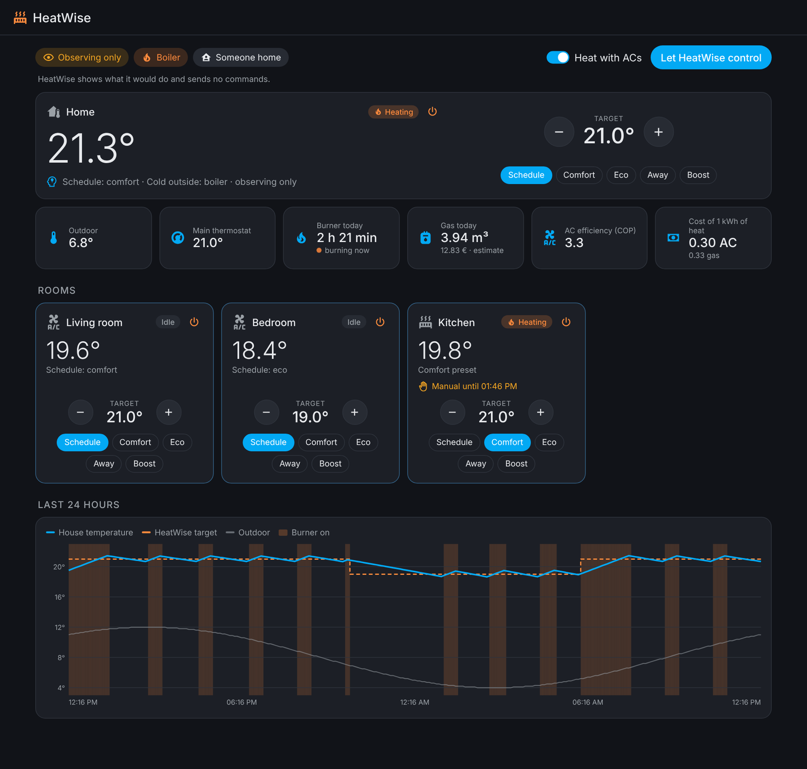
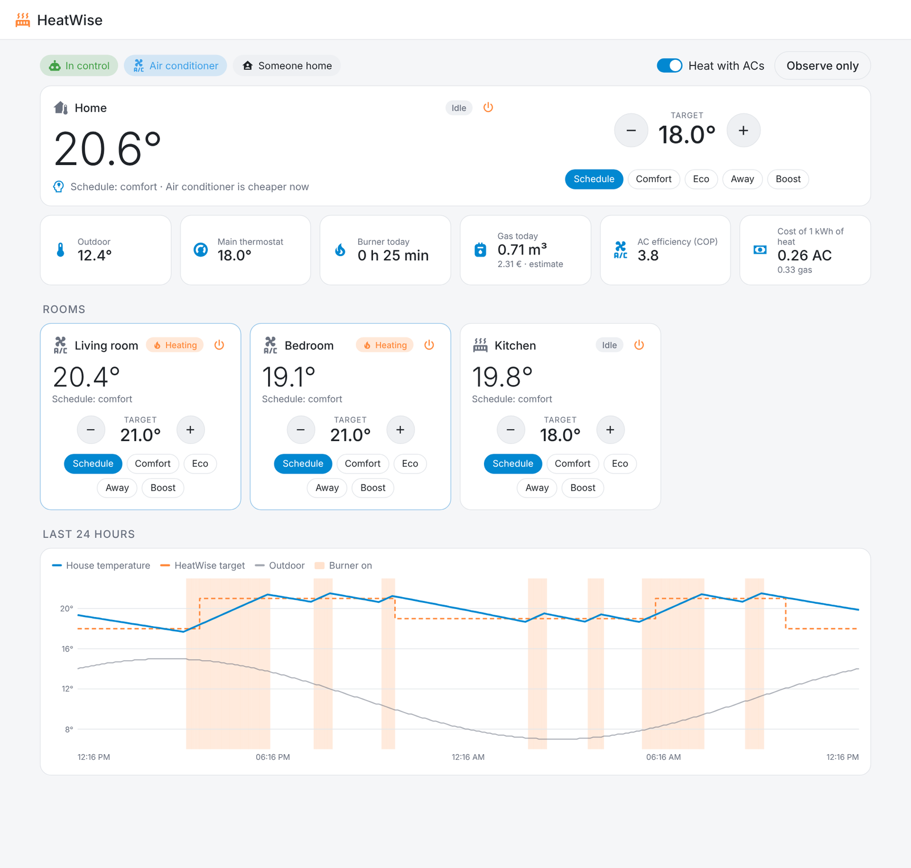
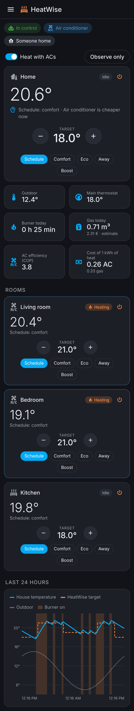

# 🌡️ HeatWise – smart hybrid heating for Home Assistant

[](https://my.home-assistant.io/redirect/hacs_repository/?owner=RazvanR1&repository=HeatWise&category=integration)

[](https://hacs.xyz/)

[](https://github.com/RazvanR1/HeatWise/actions/workflows/tests.yml)
[](https://buymeacoffee.com/razvanr1)

**HeatWise runs all your heating as one system and also decides _what_ to heat with.** Most homes
have more than one way to make heat: a gas boiler, radiator valves, and air conditioners that can
heat too. On a mild day HeatWise heats the rooms with the ACs and lets the boiler rest; when it gets
cold, or gas is cheaper, it hands the job back to the boiler. It works with any thermostat, valve or
AC that Home Assistant can see, and everything runs locally.

> 🇷🇴 [Descriere în română mai jos](#-pe-scurt-în-română)



---

## What it does

| | |
|---|---|
| 💸 **Picks the cheapest heat source** | Give it your gas and electricity prices (fixed numbers or any price sensor) and it compares gas against the AC's efficiency at the current outdoor temperature. No prices? It switches at an outdoor temperature you choose. |
| ❄️ **Runs the ACs properly** | Regulates each AC on the **room** sensor, not on the AC's own thermometer, and only switches off the units it switched on. If someone turns an AC on or off by hand, HeatWise leaves it alone for a while. |
| 🔥 **Keeps the boiler out of the way** | While the ACs heat, the main thermostat drops to the away level, so gas and electricity never heat the house at the same time. Rooms with radiator valves can call the boiler when they need heat, or simply copy the main thermostat. |
| 🏠 **Knows who is home** | Comfort while someone is home, away level when the house is empty. The away delay starts only when someone actually leaves. |
| 📅 **Follows your schedule** | Any Schedule helper (or input boolean): on = comfort, off = eco. Rooms can have their own schedule or follow the house. |
| ✋ **Respects manual changes** | Turn a thermostat by hand and the change is kept for the time you choose, or until the next schedule step. |
| 🪟 **Windows and warm days** | An open window lowers that room to frost protection; above an outdoor temperature you choose, heating stops. |
| ⚡ **Boiler power plug** (optional) | A smart plug on the boiler shows when the burner runs and for how long today. |
| ⛽ **Gas use and cost** | From the burner time HeatWise estimates the gas used today and in total (m³, kWh, money), ready for the **Energy** dashboard. Point it at your gas meter index (e.g. your supplier's integration) and it learns the real m³ per burner hour from every reading. |
| 👀 **Observe-only mode** | Turn off *HeatWise control* and it shows what it would do without touching any device. Ideal for trying it next to your current setup. |
| 🧠 **Explains itself** | A *Decision* sensor and the panel say in plain words why the house is at the temperature it is. |
| 🖥️ **Sidebar panel** | The house and every room, presets and temperatures, the heat source, burner time, the cost of heat from gas and from the AC, and the last 24 hours. |
| 🌍 **English and Romanian** | Follows your Home Assistant language automatically. |

### Screenshots

| On a mild day the ACs take over (light theme) | On the phone |
|---|---|
|  |  |

<sub>Demo data. Everything you see runs locally in Home Assistant.</sub>

### How it thinks

```
Read the house ─► Decide each room's target ─► Pick the heat source ─► Drive the devices
 people, schedule,  presence, schedule,           gas vs AC price and     boiler thermostat,
 windows, sensors   windows, manual changes       efficiency, or an       valves, ACs (or only
                                                  outdoor threshold       show it, in observe mode)
```

The cost of 1 kWh of heat is compared like this, with a 5 % margin so it does not flip back and forth:

```
gas = gas price per kWh / boiler efficiency
AC  = electricity price per kWh / COP(outdoor)
COP(outdoor) = COP at 7 °C + 0.08 × (outdoor − 7), at least 1.5
```

---

## Requirements

- Home Assistant **2025.6** or newer (any installation type: OS, Container, Core).
- At least one heater Home Assistant can control: a thermostat for the boiler, radiator valves (TRV)
  or air conditioners that can heat. One thermostat is enough to start.
- *Optional:* an outdoor temperature sensor (or a weather entity), room temperature sensors, window
  sensors, a Schedule helper, gas and electricity prices, and a smart plug with power measurement on
  the boiler.

## Installation

1. Click the **HACS** button above to open HeatWise in HACS (the **Marketplace** in Home Assistant
   2026.11+), install it and restart Home Assistant. Or add it by hand in **HACS → ⋮ → Custom
   repositories**, type **Integration**:
   ```
   https://github.com/RazvanR1/HeatWise
   ```
   Without HACS, copy `custom_components/heatwise` into `config/custom_components`.
2. Add HeatWise with this button, or from **Settings → Devices & services → Add integration → HeatWise**:

   [](https://my.home-assistant.io/redirect/config_flow_start/?domain=heatwise)

3. Pick what you have: the main thermostat, an outdoor sensor, the people, a schedule. Anything can
   stay empty.
4. Open the integration's **Configure** menu to add rooms (valves, ACs), prices and the boiler plug.
5. Open **HeatWise** in the sidebar.

**Moving from your own automations?** Turn **HeatWise control** off, watch the panel for a day or
two, then disable your old heating automations and turn **HeatWise control** on.

## Configuration (most useful options)

| Option | Default | What it does |
|---|---|---|
| Main thermostat | — | The boiler thermostat. Leave empty for a house heated only by ACs. |
| People | — | Away level when nobody is home. Without people, HeatWise assumes someone is home. |
| Schedule | — | On = comfort, off = eco. Without it: comfort while someone is home. |
| Comfort / Eco / Away / Frost | 21 / 18 / 16 / 7 °C | The temperature levels. Rooms can override comfort, eco and away. |
| Stop heating above | — | Outdoor temperature above which heating stops (1 °C hysteresis). |
| Away after | 10 min | How long after the last person leaves the house counts as empty. |
| Keep manual changes for | 120 min | Or until the next schedule step. |
| Heat source | Automatic | Automatic, boiler only or AC only. |
| Use the AC above | 8 °C | Outdoor threshold used when prices are not known. |
| Never use the AC below | −15 °C | Below this the boiler always heats. |
| AC setpoint above the target | 2 °C | How much higher HeatWise sets the AC so it heats with power; regulation is on the room sensor. |
| Gas / electricity price | — | A sensor or a fixed number, per kWh. Gas billed in m³: 1 m³ ≈ 10.5 kWh. |
| Boiler efficiency / AC COP at 7 °C | 0.92 / 3.5 | Used in the cost comparison. |
| Valves copy the main thermostat | off | Per room: the valves follow the boiler thermostat instead of their own target. |
| Boiler power sensor / Burner on above | — / 30 W | Burner on and runtime today from a smart plug. |
| Gas meter index | — | A sensor with the meter index in m³ (supplier integration, pulse counter…). Every new reading recalibrates the m³ per burner hour. |
| Gas per burner hour | 1.5 m³/h | Starting value until it is learned from the meter. |
| Energy in 1 m³ of gas | 10.5 kWh | The calorific value from your gas bill. |

### Entities

| Entity | What it is |
|---|---|
| `climate.heatwise_<house>` | The house thermostat. Presets: schedule, comfort, eco, away, boost (1 h). Setting a temperature is a manual change. Off = frost protection. |
| `climate.heatwise_<room>` | One per room, same controls. |
| `sensor.…_decision` | Why HeatWise does what it does. |
| `sensor.…_main_thermostat_target` | What HeatWise asks from the main thermostat. |
| `sensor.…_heat_source` | `boiler` or `ac`, with the estimated COP and the cost of 1 kWh of heat from each (only with an AC). |
| `sensor.…_burner_runtime_today` / `binary_sensor.…_burner_running` | Only with a boiler power plug. |
| `sensor.…_gas_today` / `sensor.…_gas_total` | Estimated gas use in m³ (the total works in the Energy dashboard). Only with a boiler power plug. |
| `sensor.…_gas_cost_today` | Today's gas cost, when the gas price is set. |
| `sensor.…_gas_per_burner_hour` | The m³ per burner hour in use, and whether it was learned from the meter. |
| `binary_sensor.…_anyone_home` | Presence as HeatWise sees it (only with people). |
| `switch.…_heatwise_control` | Off = observe only. |
| `switch.…_heat_with_air_conditioners` | Allow or block AC heating (only with an AC). |

## Privacy

- No cloud, no telemetry. HeatWise only reads and controls entities in your own Home Assistant.
- Its small state (presets, manual changes, burner time) is stored in Home Assistant's own `.storage`.
- The panel talks only to Home Assistant, through Home Assistant's websocket API.

## Current limitations

- Languages: English and Romanian. Another one is one file in `translations/` and one dictionary
  in `frontend/heatwise-panel.js` — PRs welcome.
- Gas use is an estimate from the burner time (±10–15 %); it gets better with every meter reading.
  For exact numbers, feed a pulse counter on the gas meter as the meter index.
- The AC efficiency (COP) is a simple linear estimate; set *COP at 7 °C* from your AC's datasheet
  for a better comparison.
- A boiler with an on/off room thermostat can only be asked for heat through that thermostat;
  rooms with valves raise its target when they need heat.

## Development

```bash
pip install -r requirements_test.txt
pytest
```

The tests cover the decision engine (targets, presence, schedule, the gas/AC choice and its
hysteresis, AC regulation and ownership, boiler demand) and run the integration in a real Home
Assistant instance: setup, options, observe-only mode, manual changes, presence and the panel API.

Code map: `engine.py` (pure decision logic, no Home Assistant) · `controller.py` (reads the house,
drives the devices) · `config_flow.py` (setup and options) · `climate.py` / `sensor.py` /
`binary_sensor.py` / `switch.py` (entities) · `panel.py` + `frontend/heatwise-panel.js` (sidebar panel).

## Support

HeatWise is free and open source, built in my spare time. If it helps your home, you can buy me a coffee ☕ – it keeps the project going.

<a href="https://buymeacoffee.com/razvanr1"></a>

## License

[MIT](LICENSE)

---

## 🇷🇴 Pe scurt, în română

**HeatWise – încălzire inteligentă și hibridă pentru Home Assistant.** HeatWise e o integrare pentru Home Assistant care rulează complet local și face patru lucruri:

- **Alege cu ce încălzește.** Compară prețul gazului cu cel al curentului, ținând cont de eficiența aerului condiționat la temperatura de afară, sau folosește un prag de temperatură. În zilele blânde încălzește cu AC-urile, iar centrala stă.
- **Conduce totul ca un singur sistem:** centrala, capetele termostatice și AC-urile, după senzorii din camere, programul tău și cine e acasă. Respectă modificările făcute de mână.
- **Arată cât gaz consumă centrala și cât costă**, estimat din timpul de funcționare al arzătorului și corectat singur după indexul contorului.
- **Se explică.** Panoul din bara laterală și senzorul *Decizie* spun pe înțelesul tuturor de ce casa are temperatura pe care o are.
- **Poate doar să observe**, ca să-l încerci lângă ce ai acum fără să atingă vreun aparat.

**Instalare:** apeși butonul **HACS** de mai sus (sau în HACS → ⋮ → Custom repositories adaugi
`https://github.com/RazvanR1/HeatWise`, tip **Integration**), instalezi **HeatWise**, repornești
Home Assistant și îl adaugi din **Setări → Dispozitive și servicii → Adaugă integrare → HeatWise**.
Camerele, prețurile și priza centralei le adaugi din butonul **Configurează** al integrării.
HeatWise vorbește română automat dacă Home Assistant e în română.
Documentația completă în română: [README.ro.md](README.ro.md).

Dacă HeatWise îți e de folos, mă poți susține cu o cafea: [buymeacoffee.com/razvanr1](https://buymeacoffee.com/razvanr1) ☕
