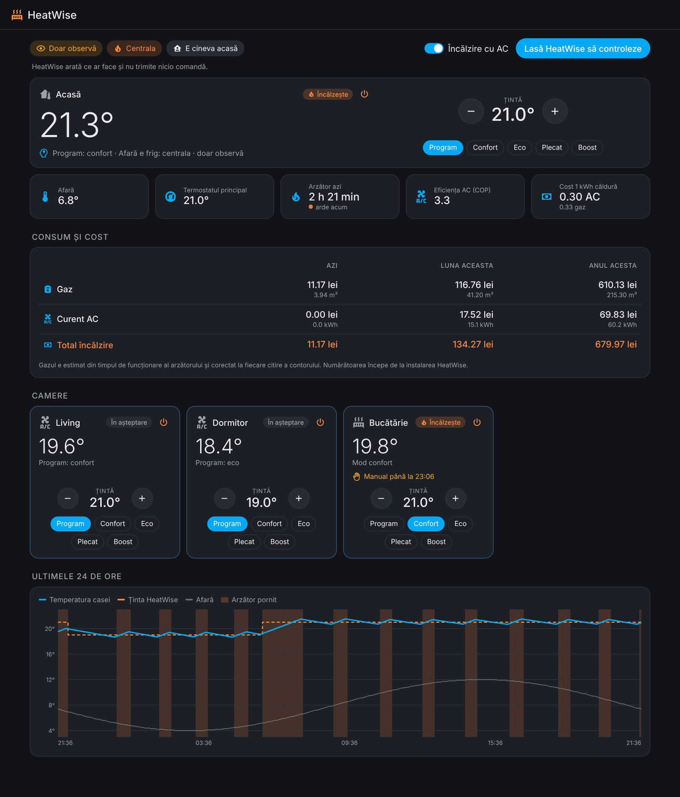
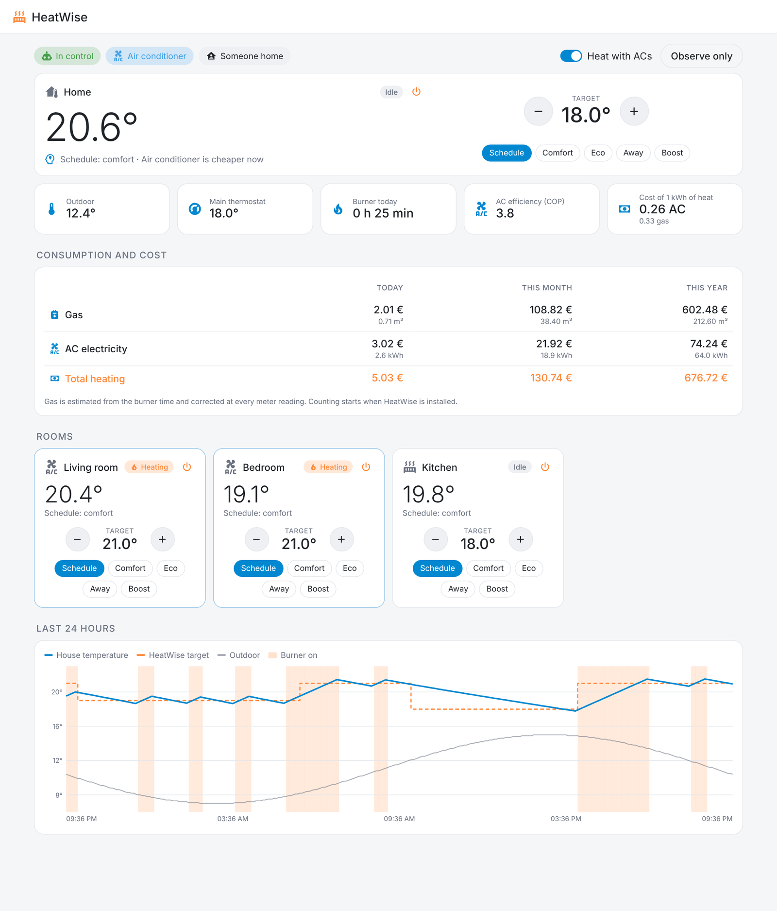
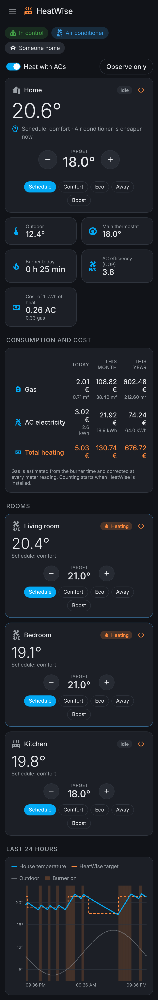

# 🌡️ HeatWise – încălzire inteligentă și hibridă pentru Home Assistant

[](https://my.home-assistant.io/redirect/hacs_repository/?owner=RazvanR1&repository=HeatWise&category=integration)

[](https://hacs.xyz/)

[](https://github.com/RazvanR1/HeatWise/actions/workflows/tests.yml)
[](https://buymeacoffee.com/razvanr1)

**HeatWise conduce toată încălzirea ca pe un singur sistem și decide și _cu ce_ încălzește.** Multe
case au mai multe surse de căldură: centrală pe gaz, capete termostatice și aere condiționate care pot
încălzi. Într-o zi blândă HeatWise încălzește camerele cu AC-urile și lasă centrala să stea; când se
face frig sau gazul e mai ieftin, predă din nou centralei. Merge cu orice termostat, cap termostatic
sau AC pe care îl vede Home Assistant, și totul rulează local.

> 🇬🇧 [English version](README.md)



---

## Ce face

| | |
|---|---|
| 💸 **Alege sursa cea mai ieftină** | Îi dai prețul la gaz și la curent (valori fixe sau orice senzor de preț) și compară gazul cu eficiența AC-ului la temperatura de afară. Fără prețuri, comută la un prag de temperatură ales de tine. |
| ❄️ **Folosește AC-urile cum trebuie** | Reglează fiecare AC după senzorul din **cameră**, nu după termometrul AC-ului, și oprește doar aparatele pornite de el. Dacă cineva pornește sau oprește un AC de mână, HeatWise nu se atinge de el o vreme. |
| 🔥 **Ține centrala deoparte** | Cât încălzesc AC-urile, termostatul principal coboară la temperatura „plecat”, ca gazul și curentul să nu încălzească casa în același timp. Camerele cu capete termostatice pot cere căldură de la centrală sau pot copia termostatul principal. |
| 🏠 **Știe cine e acasă** | Confort cât e cineva acasă, temperatura „plecat” când casa e goală. Întârzierea pornește doar când cineva chiar pleacă. |
| 📅 **Urmează programul tău** | Orice ajutor Program (Schedule) sau input boolean: pornit = confort, oprit = eco. Camerele pot avea program propriu sau urmează casa. |
| ⏰ **Cald la timp** | Învață cât de repede se încălzește fiecare cameră și pornește din timp, ca în cameră să fie deja cald când programul trece pe confort – nu o oră mai târziu. |
| 🚗 **Încălzește când vii spre casă** | Cu senzorii de distanță din integrarea Proximity a Home Assistant ridică temperatura casei de la „plecat” la confort cât timp cineva conduce spre casă. |
| 🌬️ **Sfat de aerisire** (opțional) | Cu un senzor de umiditate afară, HeatWise compară câtă apă are aerul înăuntru și afară și îți spune când câteva minute cu geamurile deschise chiar ar usca o cameră umedă. |
| 🍄 **Contra mucegaiului** (opțional) | Cu un senzor de umiditate în cameră, după câteva ore de umiditate mare (implicit 65 %) primești un mesaj să aerisești, iar camera nu coboară sub un prag (implicit 19 °C), nici când nu e nimeni acasă. O cameră încălzită doar cu AC primește doar mesajul, ca să nu pornească clima noaptea. |
| ✋ **Respectă modificările manuale** | Schimbi un termostat de mână și modificarea rămâne cât timp alegi tu sau până la următorul pas din program. |
| 🪟 **Ferestre și zile calde** | O fereastră deschisă coboară camera la protecție la îngheț; peste o temperatură exterioară aleasă de tine, încălzirea se oprește. |
| 🌬️ **Ferestre deschise fără senzori** | Când temperatura dintr-o cameră scade brusc (implicit 0,8 °C în 10 minute – o cameră încălzită nu se răcește niciodată singură atât de repede), HeatWise presupune că e o fereastră deschisă și reduce încălzirea până se încălzește din nou camera. Folosește doar senzorii de cameră și termostatul de perete. |
| ⚡ **Priză pe centrală** (opțional) | O priză inteligentă cu măsurare pe centrală arată când arde arzătorul și cât a mers azi. |
| ⛽ **Consum și cost gaz** | Din timpul și puterea arzătorului (ventilatorul unei centrale cu modulare consumă mai mult când arde mai mult), HeatWise estimează gazul consumat azi, luna aceasta, anul acesta (m³, kWh, lei) și în total, gata pentru panoul **Energie**. Îi dai indexul contorului (de exemplu din integrarea furnizorului) sau îl scrii în panou oricând citești contorul, și învață consumul real din fiecare citire. |
| 🚿 **Apa caldă separat** | La o centrală mixtă, timpul în care arzătorul merge fără ca termostatul să ceară căldură e un duș sau un robinet. HeatWise îl numără separat, așa că costul încălzirii e chiar costul încălzirii. |
| 🔌 **Curentul AC-urilor și costul total** | Cu un senzor de putere pe fiecare AC (o priză inteligentă), numără energia și costul AC-urilor **cât încălzesc** – azi, luna aceasta, anul acesta – și le adună cu gazul pentru costul total al încălzirii. |
| 🔔 **Notificări** (opțional) | Pe telefon, pe Telegram sau la orice serviciu de notificare: o fereastră lăsată deschisă, un termostat, cap sau AC care nu mai răspunde și un raport săptămânal duminică seara cu gazul, curentul și costul săptămânii. |
| 👀 **Mod doar observă** | Oprești *Control HeatWise* și îți arată ce ar face, fără să atingă vreun aparat. Ideal ca să-l încerci lângă ce ai acum. Când îl oprești (sau ștergi HeatWise), oprește și AC-urile pe care le pornise el. |
| 🧠 **Se explică** | Senzorul *Decizie* și panoul spun pe înțelesul tuturor de ce casa are temperatura pe care o are. |
| 🖥️ **Panou în bara laterală** | Casa și fiecare cameră, preseturi și temperaturi, sursa de căldură, cât a mers arzătorul, cât costă căldura din gaz și din AC și ultimele 24 de ore. |
| 🔧 **Îți cunoaște aparatele** (opțional) | Îi spui centrala și clima din fișa tehnică sau de pe eticheta energetică – câteva cifre, fără o bază de date de modele care să se învechească – și comparația de cost și estimarea gazului folosesc randamentele tale reale. Ce lași gol primește media pentru tipul de aparat. |
| 🌍 **Română și engleză** | Urmează limba din Home Assistant sau alegi una doar pentru HeatWise. |

### Capturi

| Într-o zi blândă preiau AC-urile (temă deschisă) | Pe telefon |
|---|---|
|  |  |

<sub>Date demonstrative. Tot ce vezi rulează local în Home Assistant.</sub>

### Cum gândește

```
Citește casa ─► Decide ținta fiecărei camere ─► Alege sursa de căldură ─► Comandă aparatele
 persoane,       prezență, program,               preț gaz vs AC și          termostatul centralei,
 program,        ferestre, modificări manuale     eficiență, sau un prag     capete, AC-uri (sau doar
 ferestre,                                        de temperatură afară       arată, în modul observă)
 senzori
```

Costul unui kWh de căldură se compară așa, cu o marjă de 5 % ca să nu comute încolo și încoace:

```
gaz = preț gaz per kWh / randament centrală
AC  = preț curent per kWh / COP(afară)
COP(afară) = COP la 7 °C + 0,08 × (afară − 7), minim 1,5
```

---

## Cerințe

- Home Assistant **2025.6** sau mai nou (orice tip de instalare: OS, Container, Core).
- Cel puțin un aparat de încălzire pe care Home Assistant îl poate comanda: termostatul centralei,
  capete termostatice (TRV) sau aere condiționate care pot încălzi. Un singur termostat ajunge ca să începi.
- *Opțional:* senzor de temperatură exterioară (sau o entitate de vreme), senzori de temperatură în
  camere, senzori de fereastră, un ajutor Program, prețurile la gaz și curent și o priză inteligentă
  cu măsurare pe centrală.

## Instalare

1. Apeși butonul **HACS** de mai sus ca să deschizi HeatWise în HACS (**Marketplace** din Home
   Assistant 2026.11+), îl instalezi și repornești Home Assistant. Sau îl adaugi de mână din
   **HACS → ⋮ → Custom repositories**, tip **Integration**:
   ```
   https://github.com/RazvanR1/HeatWise
   ```
   Fără HACS, copiezi `custom_components/heatwise` în `config/custom_components`.
2. Adaugi HeatWise cu acest buton sau din **Setări → Dispozitive și servicii → Adaugă integrare → HeatWise**:

   [](https://my.home-assistant.io/redirect/config_flow_start/?domain=heatwise)

3. Alegi ce ai: termostatul principal, senzorul de afară, persoanele, un program. Pe pagina următoare,
   centrala și clima din fișa tehnică. Poți lăsa orice gol.
4. Din meniul **Configurează** al integrării adaugi camere (capete, AC-uri), prețuri și priza centralei.
5. Deschizi **HeatWise** din bara laterală.

**Treci de la automatizările tale?** Oprește **Control HeatWise**, urmărește panoul o zi-două, apoi
dezactivează automatizările vechi de încălzire și pornește **Control HeatWise**.

## Configurare (cele mai folositoare opțiuni)

| Opțiune | Implicit | Ce face |
|---|---|---|
| Termostatul principal | — | Termostatul centralei. Lasă gol pentru o casă încălzită doar cu AC. |
| Persoane | — | Temperatura „plecat” când nu e nimeni acasă. Fără persoane, HeatWise consideră că e cineva acasă. |
| Program | — | Pornit = confort, oprit = eco. Fără el: confort cât e cineva acasă. |
| Confort / Eco / Plecat / Îngheț | 21 / 18 / 16 / 7 °C | Nivelurile de temperatură. Camerele pot avea confort, eco și plecat proprii. |
| Oprește încălzirea peste | — | Temperatura de afară peste care se oprește încălzirea (histerezis 1 °C). |
| Plecat după | 10 min | Cât timp după plecarea ultimei persoane casa e considerată goală. |
| Păstrează modificările manuale | 120 min | Sau până la următorul pas din program. |
| Limba | Automat | Limba panoului, a textelor de decizie și a notificărilor; automat urmează Home Assistant. |
| Pornește din timp înainte de program | pornit | Pornește confortul înaintea programului după viteza de încălzire măsurată de HeatWise (1,5 °C/h până măsoară una). Are nevoie de un ajutor Program (Schedule). |
| Pornește cu cel mult atâtea minute înainte | 180 min | Limita de sus pentru pornirea din timp. |
| Distanța până acasă | — | Senzorii de distanță Proximity, câte unul pe persoană; dacă există, se folosește și senzorul de direcție din aceeași intrare. |
| Încălzește când e mai aproape de | 15 km | Cineva care vine spre casă (cu cel puțin 1 km mai aproape decât cel mai departe punct) în această distanță readuce casa la confort, cel mult 45 de minute. |
| Spune-mi când e bine să aerisesc | pornit | Are nevoie de senzorul de umiditate de afară. O cameră peste 60 % și aer clar mai uscat afară: un mesaj, cel mult o dată la 6 ore, între 8:00 și 22:00, când e cineva acasă. |
| Protecție contra mucegaiului | pornit, 65 %, 2 h, 19 °C | Are nevoie de un senzor de umiditate pe cameră (sau pe casă). După atâta timp peste acea umiditate: mesaj să aerisești, iar camera stă cel puțin atât de caldă până scade umiditatea cu 3 %. |
| Trimite la | — | Serviciile de notificare pentru mesaje, de exemplu `notify.mobile_app_telefon`. |
| Alertele de fereastră se trimit și la | — | Servicii de notificare care primesc doar mesajele de fereastră deschisă, de exemplu telefonul altcuiva din casă. |
| Fereastră deschisă / dispozitiv care nu răspunde / raport săptămânal | pornit / pornit / pornit | Ce mesaje să trimită. Raportul pleacă duminica la 19:00. |
| Sursa de căldură | Automat | Automat, doar centrala sau doar AC. |
| Folosește AC-ul peste | 8 °C | Pragul de temperatură exterioară când prețurile nu sunt cunoscute. |
| Nu folosi niciodată AC-ul sub | −15 °C | Sub această temperatură încălzește mereu centrala. |
| Temperatura maximă pentru restul casei când o cameră cu valvă cere căldură | fără limită | Caloriferele fără valvă încălzesc ori de câte ori centrala merge pentru o cameră cu valvă. Cu o valoare, termostatul principal nu e ridicat niciodată peste ea: camera cu valvă poate rămâne puțin mai rece. |
| Restul casei cât încălzesc AC-urile | temperatura de plecat | Ce ține termostatul principal cât AC-urile încălzesc camerele lor. Niciodată peste ce cere programul casei. |
| Cu cât setează AC-ul peste țintă | 2 °C | Cât de sus setează HeatWise AC-ul ca să încălzească cu putere; reglajul se face după senzorul din cameră. |
| Preț gaz / curent | — | Un senzor sau o valoare fixă, per kWh. Gaz facturat în m³: 1 m³ ≈ 10,5 kWh. |
| Tipul centralei / puterea maximă la încălzire / randamentul (%) | nu știu / — / — | Din fișa tehnică. Randamentul e valoarea la sarcină maximă raportată la Hi (de exemplu 97,5 %); gol = media pentru tip (în condensare 0,93, clasică 0,84, nu știu 0,92, raportat la kWh de pe factura de gaz). Din putere pornește estimarea gazului pe oră de funcționare. |
| Capacitatea AC la încălzire / puterea consumată (W) | — | Din fișa tehnică (de exemplu 3399 W / 916 W → COP 3,71). Gol = din clasa energetică la încălzire (A+++ … B), altfel un COP mediu de 3,5. |
| Senzori de putere AC | — | Pe cameră: senzorii de putere (prizele) ai AC-urilor, pentru energia și costul cât încălzesc. |
| Capetele copiază termostatul principal | oprit | Pe cameră: capetele urmează termostatul centralei în loc de ținta proprie. |
| Senzor de putere centrală / Arzător pornit peste | — / 30 W | Arzător pornit și timpul de funcționare azi, din priza inteligentă. |
| Indexul contorului de gaz | — | Un senzor cu indexul în m³ (integrarea furnizorului, numărător de impulsuri…). Fiecare citire nouă recalibrează m³ pe oră de funcționare. |
| Gaz pe oră de funcționare | din puterea centralei, altfel 1,5 m³/h | Valoarea de pornire până o învață din contor. |
| Socotește gazul după puterea prizei | pornit | O ardere la o putere mai mare decât de obicei contează proporțional mai mult (între 0,5× și 1,6×). Citirile contorului corectează scara. |
| Socotește separat apa caldă | pornit | Timpul în care arzătorul merge fără ca termostatul principal să ceară căldură (după 90 s de toleranță) e apă caldă. Are nevoie de termostatul principal. |
| Detectează ferestre deschise din scăderea temperaturii | pornit, 0,8 °C în 10 min, cel mult 30 min | Coboară camera la protecție la îngheț când senzorul ei scade brusc; revine imediat ce se încălzește din nou cu 0,3 °C. |
| Energie într-un m³ de gaz | 10,5 kWh | Puterea calorifică de pe factura de gaz. |

### Entități

| Entitate | Ce este |
|---|---|
| `climate.heatwise_<casa>` | Termostatul casei. Preseturi: program, confort, eco, plecat, boost (1 h). O temperatură setată e o modificare manuală. Oprit = protecție la îngheț. |
| `climate.heatwise_<camera>` | Câte unul pe cameră, aceleași comenzi. |
| `sensor.…_decision` | De ce face HeatWise ce face. Atributele arată și camerele care se încălzesc din timp, dacă vine cineva spre casă și viteza de încălzire învățată pe fiecare cameră. |
| `sensor.…_main_thermostat_target` | Ce cere HeatWise de la termostatul principal. |
| `sensor.…_heat_source` | `boiler` (centrala) sau `ac`, cu COP-ul estimat și costul unui kWh de căldură din fiecare (doar cu AC). |
| `sensor.…_burner_runtime_today` / `binary_sensor.…_burner_running` | Doar cu priză pe centrală. |
| `sensor.…_gas_today` / `…_gas_this_month` / `…_gas_this_year` / `…_gas_total` | Gazul consumat estimat, în m³ (totalul merge în panoul Energie). Doar cu priză pe centrală. |
| `sensor.…_gas_cost_today` / `…_this_month` / `…_this_year` | Costul gazului, dacă e setat prețul gazului. |
| `sensor.…_ac_heating_energy_today` / `…_this_month` / `…_this_year` și `…_ac_heating_cost_…` | Energia și costul AC-urilor cât încălzesc. Doar cu senzori de putere pe AC. |
| `sensor.…_hot_water_gas_today` / `…_this_month` / `…_this_year` și `…_hot_water_cost_…` | Gazul și costul apei calde (centrală mixtă cu termostat principal). |
| `sensor.…_heating_cost_today` / `…_this_month` / `…_this_year` | Gazul pentru încălzire și AC împreună; apa caldă e lăsată deoparte când e numărată separat. |
| `number.…_gas_meter_reading` | Scrii indexul contorului de gaz oricând îl citești; fiecare citire corectează estimarea. E și în panou. |
| `sensor.…_gas_per_burner_hour` | Câți m³ pe oră de funcționare folosește acum și dacă i-a învățat din contor. |
| `binary_sensor.…_anyone_home` | Prezența așa cum o vede HeatWise (doar cu persoane). |
| `switch.…_heatwise_control` | Oprit = doar observă. |
| `switch.…_heat_with_air_conditioners` | Permite sau blochează încălzirea cu AC (doar cu AC). |

## Confidențialitate

- Fără cloud, fără telemetrie. HeatWise doar citește și comandă entități din Home Assistant-ul tău.
- Starea lui (preseturi, modificări manuale, timpul arzătorului) e păstrată în `.storage` al Home Assistant.
- Panoul vorbește doar cu Home Assistant, prin API-ul websocket al Home Assistant.

## Limitări actuale

- Limbi: română și engleză. Una nouă înseamnă un fișier în `translations/` și un dicționar în
  `frontend/heatwise-panel.js` — PR-urile sunt binevenite.
- Consumul de gaz e o estimare din timpul și puterea arzătorului (±10 %) și se îmbunătățește cu fiecare
  citire a contorului. Pentru valori exacte, dă-i ca index un numărător de impulsuri de pe contor.
- Apa caldă folosită cât merge încălzirea se numără la încălzire: centrala nu-i poate spune lui HeatWise.
- Eficiența AC-ului (COP) e o estimare liniară simplă; pune *COP la 7 °C* din fișa tehnică a AC-ului
  pentru o comparație mai bună.
- O centrală cu termostat de cameră pornit/oprit poate fi rugată să încălzească doar prin acel
  termostat; camerele cu capete îi ridică ținta când au nevoie de căldură.

## Dezvoltare

```bash
pip install -r requirements_test.txt
pytest
```

Testele acoperă motorul de decizie (ținte, prezență, program, alegerea gaz/AC și histerezisul ei,
reglajul și „proprietatea” AC-urilor, cererea de căldură pentru centrală) și rulează integrarea
într-un Home Assistant real: configurare, opțiuni, modul doar observă, modificări manuale, prezență
și API-ul panoului.

Harta codului: `engine.py` (logica de decizie, fără Home Assistant) · `controller.py` (citește casa,
comandă aparatele) · `config_flow.py` (configurare și opțiuni) · `climate.py` / `sensor.py` /
`binary_sensor.py` / `switch.py` (entități) · `panel.py` + `frontend/heatwise-panel.js` (panoul din bara laterală).

## Susține proiectul

HeatWise e gratuit și open source, făcut în timpul meu liber. Dacă îți ajută casa, îmi poți da o cafea ☕ – asta ține proiectul în viață.

<a href="https://buymeacoffee.com/razvanr1"></a>

## Licență

[MIT](LICENSE)
