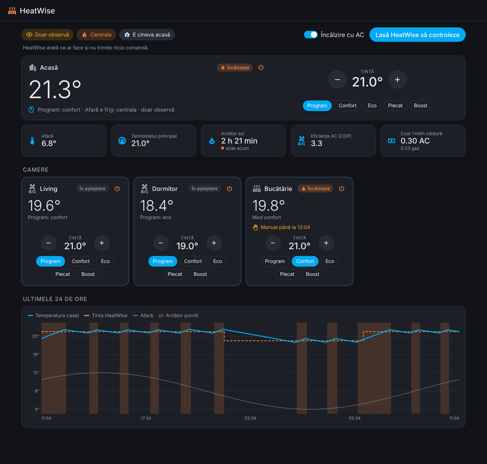
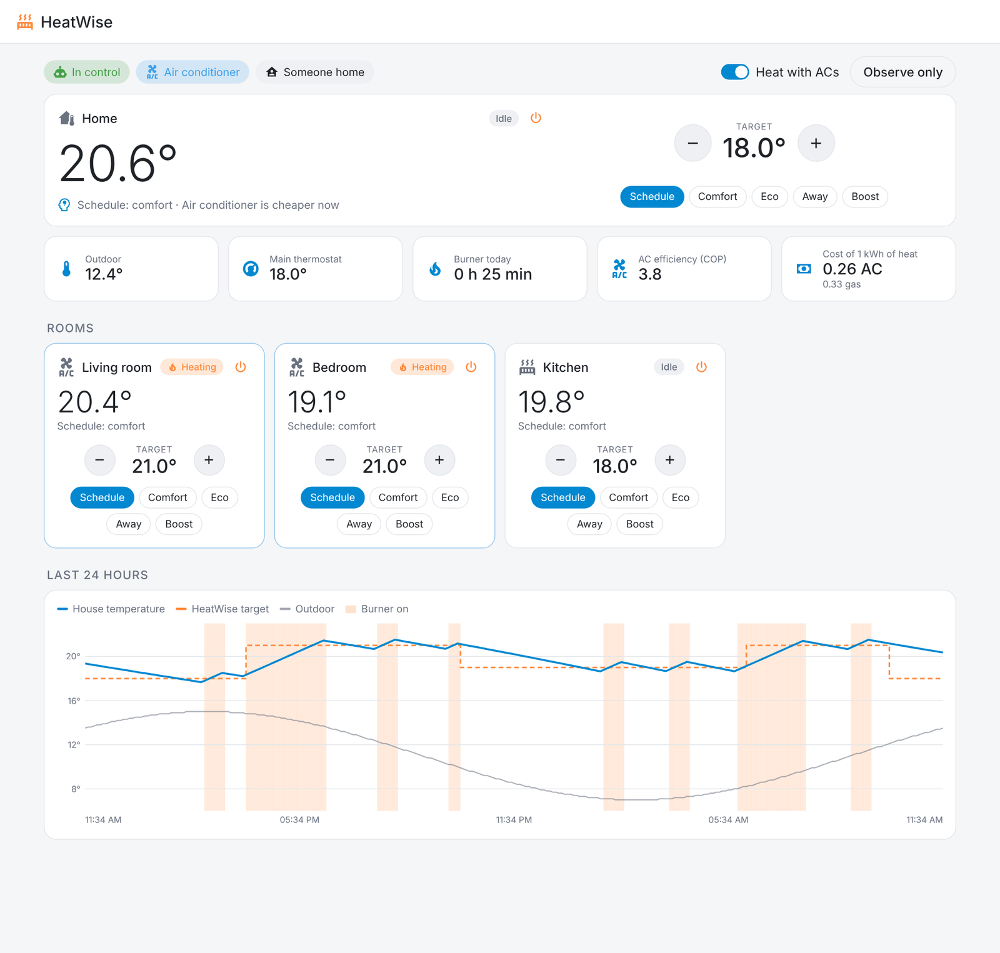
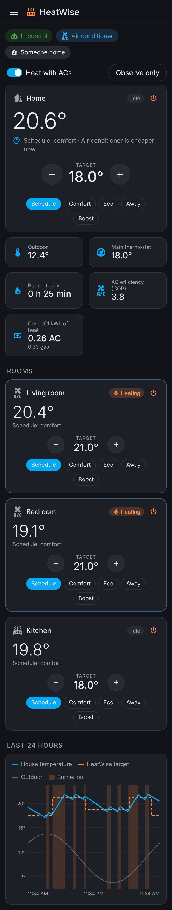

# HeatWise

[English](README.md) | **Română**

**Încălzire inteligentă pentru Home Assistant, care decide și _cu ce_ încălzește.**

Multe case au mai multe surse de căldură: centrală pe gaz, capete termostatice
și aere condiționate care pot încălzi. HeatWise le conduce pe toate ca pe un
singur sistem. Într-o zi blândă încălzește camerele cu aerul condiționat și
lasă centrala să stea; când se face frig sau gazul e mai ieftin, predă din nou
centralei. Merge cu orice termostat, cap termostatic sau AC pe care îl vede
Home Assistant.



## Ce face

- **Alege sursa cea mai ieftină.** Îi dai prețul la gaz și la curent (valori
  fixe sau orice senzor de preț) și compară gazul cu eficiența AC-ului la
  temperatura de afară. Fără prețuri, comută la un prag de temperatură ales de tine.
- **Reglează AC-ul după senzorul din cameră**, nu după termometrul AC-ului, și
  oprește doar aparatele pornite de el. Dacă cineva pornește sau oprește un AC
  de mână, HeatWise nu se atinge de el o vreme.
- **Știe cine e acasă.** Confort cât e cineva acasă, temperatura „plecat” când
  casa e goală (după o întârziere aleasă de tine).
- **Urmează programul tău.** Orice ajutor Program (Schedule) sau input boolean:
  pornit = confort, oprit = eco. Zonele pot avea program propriu sau urmează casa.
- **Camere cu capete termostatice:** țintă proprie, pot cere căldură de la
  centrală sau pot copia termostatul principal.
- **Ferestre:** o fereastră deschisă coboară zona la protecție la îngheț.
- **Modificările manuale sunt respectate** cât timp alegi tu sau până la
  următorul pas din program.
- **Cald afară:** oprește încălzirea peste o temperatură exterioară.
- **Priză pe centrală (opțional):** arată când arde arzătorul și cât a mers azi.
- **Mod doar observă:** oprești comutatorul *Control HeatWise* și îți arată ce
  ar face, fără să atingă vreun aparat. Ideal ca să-l încerci lângă ce ai acum.
- **Panou propriu în bara laterală:** toate camerele dintr-o privire, preseturi și temperaturi, sursa de căldură, timpul arzătorului și un grafic pe 24 de ore.
- **Se explică:** senzorul *Decizie* spune pe înțelesul tuturor de ce casa are
  temperatura pe care o are. Engleză și română.

Totul în afară de nume e opțional: un singur termostat ajunge ca să începi.

## Panoul

HeatWise are pagina lui în bara laterală din Home Assistant. Acolo găsești tot:
casa și fiecare cameră, preseturi și temperaturi, de ce a decis așa, sursa de
căldură, cât a mers arzătorul, cât costă căldura din gaz și din AC și ultimele
24 de ore.

| Într-o zi blândă preiau AC-urile (temă deschisă) | Pe telefon |
|---|---|
|  |  |

Panoul folosește limba din profilul tău Home Assistant (română sau engleză).

## Instalare

1. În HACS (**Marketplace** din Home Assistant 2026.11+): ⋮ → **Custom
   repositories** → `https://github.com/RazvanR1/HeatWise`, tip
   **Integration**. Instalează **HeatWise** și repornește Home Assistant.
   Fără HACS, copiază `custom_components/heatwise` în `config/custom_components`.
2. **Setări → Dispozitive și servicii → Adaugă integrare → HeatWise.**
3. Alege ce ai: termostatul principal, senzorul de afară, persoanele, un
   program. Poți lăsa orice gol.
4. Din meniul **Configurează** al integrării adaugi zone (capete, AC-uri),
   prețuri și priza centralei.

Necesită Home Assistant 2025.6 sau mai nou.

## Cum alege sursa de căldură

Cu ambele prețuri cunoscute:

```
cost căldură gaz = preț gaz per kWh / randament centrală
cost căldură AC  = preț curent per kWh / COP(afară)
COP(afară)       = COP la 7 °C + 0,08 × (afară − 7), minim 1,5
```

Folosește AC-ul când e cu cel puțin 5 % mai ieftin și revine la centrală când
e cu 5 % mai scump, ca să nu comute încolo și încoace. Sub temperatura „nu
folosi niciodată AC-ul sub” folosește mereu centrala. Gaz facturat în m³?
1 m³ ≈ 10,5 kWh.

Cât încălzesc AC-urile, termostatul principal coboară la temperatura „plecat”,
ca centrala să nu pornească, iar capetele din camerele cu AC se închid.

## Trecerea de la automatizările tale

1. Instalează HeatWise și oprește **Control HeatWise**.
2. Urmărește senzorul *Decizie* și țintele o zi-două.
3. Dezactivează automatizările vechi de încălzire, apoi pornește **Control HeatWise**.

## Susține proiectul

Dacă HeatWise îți folosește: [Buy me a coffee](https://buymeacoffee.com/razvanr1).

## Licență

MIT
